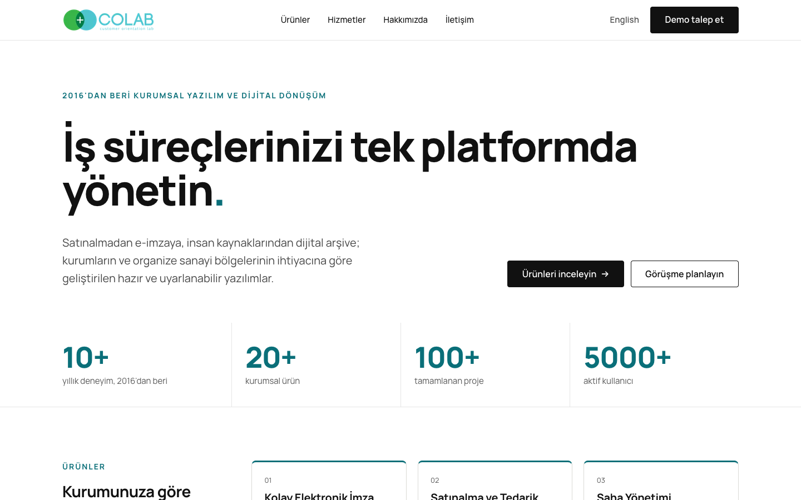
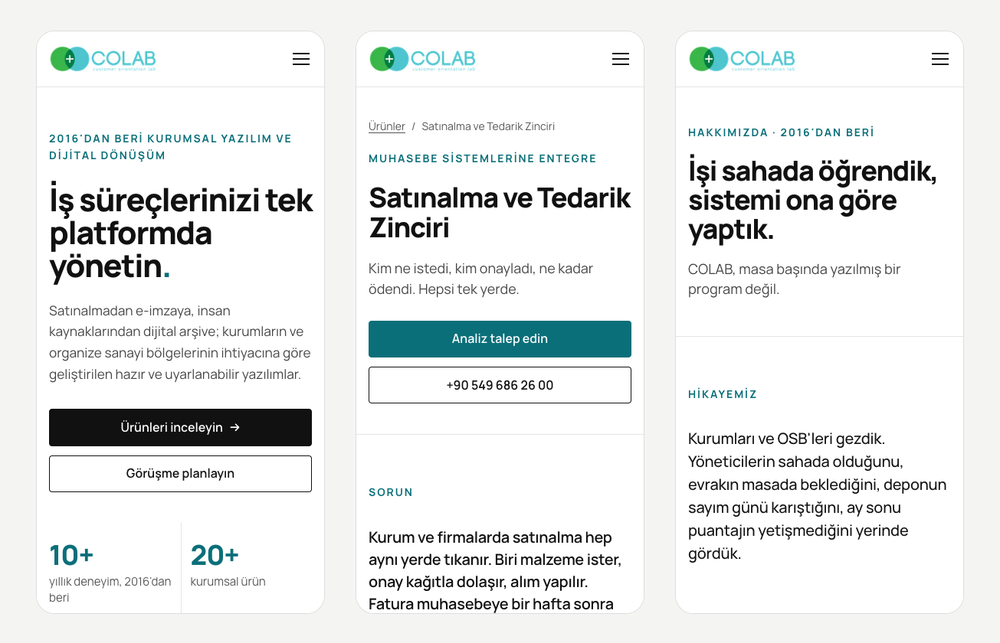

# COLAB website

The corporate website of **COLAB**, an Istanbul-based software company that builds enterprise software for companies and organised industrial zones (OSB): e-signature, document tracking, procurement, field operations, HR, quality management and more.

**Live:** [www.colab.com.tr](https://www.colab.com.tr) · [English](https://www.colab.com.tr/en/)



## Highlights

- **Bilingual, with translated URLs.** Turkish at `/`, English at `/en/`. Page addresses are translated too (`/urunler/satinalma/` ↔ `/en/products/satinalma/`, `/hakkimizda/` ↔ `/en/about/`), and the language switch always lands on the same page in the other language. Every page declares its counterpart with `hreflang`.
- **Content as typed data.** Products, services, the About and consulting copy, company facts and the KVKK notice live in TypeScript files under `src/data/`. The ten product detail pages are generated from one template, and a section is simply left out when a product has no copy for it.
- **Fast and static.** 29 pages, about 800 KB in total. The only JavaScript is a short inline script that opens the mobile menu.
- **Private by default.** No cookies, no analytics, no third-party requests. The Manrope font is self-hosted rather than loaded from Google Fonts, which keeps the site simple under Turkey's data protection law (KVKK).
- **Ready for search and sharing.** Sitemap, `robots.txt`, canonical URLs, Organization and WebSite structured data, a full favicon set and an Open Graph image for link previews.
- **Responsive and accessible.** Designed mobile-first and checked at phone, tablet and desktop widths, with semantic landmarks, a skip link and screen-reader-friendly figures.



## Pages

| Page | Turkish | English |
|---|---|---|
| Home | `/` | `/en/` |
| Product detail (×10) | `/urunler/<slug>/` | `/en/products/<slug>/` |
| About | `/hakkimizda/` | `/en/about/` |
| Consulting | `/danismanlik/` | `/en/consulting/` |
| Privacy notice (KVKK) | `/kvkk/` | `/en/kvkk/` |
| Not found | `/404.html` | |

## Tech stack

- [Astro](https://astro.build) 7, static output
- TypeScript for content and helpers
- Plain CSS with design tokens (`src/styles/global.css`), no CSS framework
- [`@astrojs/sitemap`](https://docs.astro.build/en/guides/integrations-guide/sitemap/) and [`@fontsource-variable/manrope`](https://fontsource.org/fonts/manrope)

## Getting started

Requires Node.js 22.23 or later.

```sh
npm install
npm run dev      # dev server at http://localhost:4321
npm run build    # static site in dist/
npm run preview  # serve the production build locally
```

## Project structure

```
src/
├── components/
│   ├── home/          Home page sections (hero, figures, products, services, about, contact)
│   ├── product/       Product detail page template
│   ├── about/         About page
│   ├── consulting/    Consulting page
│   └── legal/         Layout for legal texts
├── data/
│   ├── site.ts        Company facts, figures and site-wide switches
│   ├── products.ts    Product list and order
│   ├── product-details/  Long-form copy for each product page (TR + EN)
│   ├── services.ts, about.ts, consulting.ts
│   └── legal/kvkk.ts  The privacy notice
├── i18n/ui.ts         Interface strings in both languages and the URL helpers
├── layouts/           The page shell: head, header, footer
├── pages/             Routes; English routes live under pages/en/
└── styles/global.css  Colours, type, spacing and shared layout
public/                Favicons, share image, .htaccess and the Search Console file
```

## Common edits

| To change | Edit |
|---|---|
| Phone, email, address, figures | `src/data/site.ts` |
| A product's name, summary or order | `src/data/products.ts` |
| A product page's copy | `src/data/product-details/<slug>.ts` |
| Add a product page | Create a file in `src/data/product-details/` and reference it as `detail` in `products.ts`; the page and links appear automatically |
| Menu, buttons and other interface text | `src/i18n/ui.ts` |
| The privacy notice | `src/data/legal/kvkk.ts` |

**Screenshots** of the product interface are switched off until the interface is redesigned. Setting `showScreenshots` to `true` in `src/data/site.ts` brings back the frames on the home page hero, the featured product cards and the product pages.

## Deployment

The site is hosted on an Apache server managed through Plesk. The same server also handles the company's email, so deployments only touch the web root.

1. Run `npm run build` with none of the environment variables below set.
2. Zip the **contents** of `dist/`, including the hidden `.htaccess`.
3. In Plesk, upload the zip to `httpdocs`, extract it over the existing files and delete the zip.

Do not remove these files from the server:

- `.htaccess` sets `index.html` as the start page and serves the custom 404 page.
- `google52d7ac3f079f683b.html` keeps the Google Search Console property verified.

HTTPS uses a Let's Encrypt certificate for `colab.com.tr` and `www.colab.com.tr`, issued in Plesk. Plesk also redirects HTTP to HTTPS and the bare domain to `www`.

### Environment variables

All of them are optional and only needed for a staging copy.

| Variable | Default | Purpose |
|---|---|---|
| `SITE_URL` | `https://www.colab.com.tr` | Origin used for canonical, hreflang, sitemap and share image URLs |
| `BASE_PATH` | `/` | Sub-folder the site is served from |
| `PUBLIC_NOINDEX` | unset | Set to `true` to keep search engines away from a staging copy |

## Privacy notes

- The site sets **no cookies**. Adding analytics, embedded videos or anything else that sets cookies requires a cookie policy page and, for non-essential cookies, a consent banner.
- The KVKK notice describes contact by email and phone only. If a contact or demo form is added, sections 2 and 5 of the notice must be updated.
- Hosting and email are in Turkey. Moving either abroad requires a cross-border transfer statement in the notice.

## Known gaps

- The logo is a PNG taken from the old site. Replace it with an SVG when one is available.
- Performance Management is listed without a detail page until its copy is ready.
- The English product copy is a first translation and could use a native review.

## License

The code is published for reference. The content, brand and logo belong to COLAB Bilişim Hizmetleri Limited Şirketi. All rights reserved.
